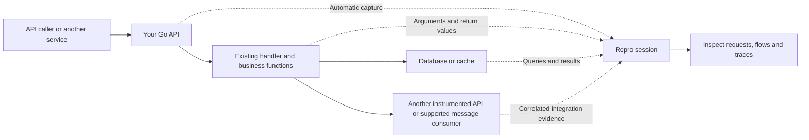

# Repro Go SDK

Initialize once and build with `repro-go`. The build instruments application
functions and supported library calls. Do not replace your HTTP handlers,
database clients, transactions, or Kafka processing code with Repro wrappers.
The SDK uses the existing Repro collector and API contracts.

**Only APIs, no frontend?** Follow the [API-only quickstart](#api-only-quickstart)
below. You do not need the JavaScript SDK.

## Install from the private repository

Requires Go 1.26 or newer and read access to `getrepro/go-sdk`. Authenticate Git
with GitHub first (for example, `gh auth login` then `gh auth setup-git`). Keep any
existing `GOPRIVATE` entries when adding this module:

```sh
go env -w GOPRIVATE=github.com/getrepro/go-sdk
go get github.com/getrepro/go-sdk@v0.1.1
go install github.com/getrepro/go-sdk/cmd/repro-go@v0.1.1
```

Add `$(go env GOPATH)/bin` to `PATH`. No local module replacement is needed.

Hosted Repro endpoints are configured automatically. Approved policies are
still fetched and applied unless an inline policy or explicit raw capture is used.

## API-only quickstart

### 1. Initialize once before starting your existing server

Use your Repro app credentials. Keep your existing routes, handlers and database
code unchanged. `Mode: "live"` starts capture automatically for eligible incoming
requests, without browser recordings or caller-supplied session headers.

```go
rate := 1.0 // Start with 100% sampling for verification; quotas still apply.

sdk, err := repro.Init(repro.Config{
    TenantID:    os.Getenv("REPRO_TENANT_ID"),
    AppID:       os.Getenv("REPRO_APP_ID"),
    AppSecret:   os.Getenv("REPRO_APP_SECRET"),
    AppName:     "orders-api",
    ServiceName: "Orders API",
    Mode:        "live",
    ActorID:     "orders-api",
    Live: repro.LiveConfig{
        Policy: repro.LivePolicy{SampleRate: &rate},
    },
    Privacy: repro.PrivacyConfig{Environment: "dev"},
})
if err != nil {
    log.Printf("Repro unavailable: %v", err)
}
```

Use the policy environment configured for your service. `live` is the capture
mode, not the environment: it also works with a `dev` policy. When initialization
succeeds, call `sdk.Shutdown(ctx)` from your existing graceful-shutdown handler,
after stopping incoming work. See the [initialization/shutdown example below](#browser-correlated-setup)
for error handling and bounded shutdown; keep the live configuration above.

### 2. Build and run

```sh
repro-go build -o orders-api .
./orders-api
```

Use your application's package path instead of `.` if its entry point lives in
another directory. Use `repro-go build`, not ordinary `go build`.

### 3. Call your API normally, then inspect the session in Repro

```sh
curl http://localhost:8080/orders
```

Use an existing endpoint and port from your application. No special request
headers or recording button are required.



Repro records supported operations that actually run inside the captured work,
subject to privacy rules and capture limits. There is no screen replay or browser
action timeline because there is no frontend. Initialize and build each service
you want to inspect with its own service name.

### When does a session start and end?

For this example, `ActorID: "orders-api"` groups traffic at the service level.
It does not identify individual customers. Requests for the same app and actor
share the active window, including concurrent requests.
The API assigns windows of up to three minutes; this is not a sliding timer
that resets after every request.

| Event | What Repro does |
| --- | --- |
| Your API process starts | Initializes the SDK. No session starts just because the process is running. |
| First eligible incoming request | Checks sampling and quotas. If admitted, starts a backend session. |
| More requests in the same three-minute window | Adds them to that session for the same app and actor. Each request remains separately inspectable. |
| The three-minute window ends | Stops admitting new independent requests into that session. This does not cancel application requests. |
| Another request arrives after the boundary | If admitted, records it in the next linked session segment. No traffic means no empty continuation is created. |
| Work from the earlier window finishes | Uploads its evidence to the original session, even if it finishes after the three-minute boundary. |
| Expected evidence has arrived and been processed | The session can become complete. This can be later than the end of the capture window. |

For example, with continuous traffic and the same app/actor:

```text
10:00:00  GET /orders          -> Session A starts
10:01:00  POST /orders         -> Session A
10:02:50  POST /export starts  -> Session A
10:03:00                       -> A closes to new independent requests
10:03:05  GET /orders          -> Session B starts (continuation)
10:03:20  /export finishes     -> Its response and traces still belong to A
                               A completes after its expected evidence is processed
```

You do not manually start, stop or promote these live sessions. A request ending
does not immediately end its three-minute session window. For example, one
one-second request can still leave its session processing until the window closes
and ingestion finishes. There is no fixed promise that completion occurs at
exactly three minutes.

The three-minute limit applies to admitting new work, not to forcibly stopping a
long-running handler. Detached correlated work after a handler returns is bounded
separately by `DrainTimeout` (30 seconds by default). Shutdown, delivery failures
or capture limits can leave evidence incomplete; the SDK reports these rather
than promising unlimited capture.

For per-customer identity, lower sampling rates, message consumers or workers,
see [Backend-only applications](docs/backend-only.md).

## Browser-correlated setup

Use this staging configuration when an upstream recording already supplies
session correlation, for example through the browser SDK. For APIs with no
frontend, use the live configuration above instead.

Add initialization before starting servers or consumers:

```go
package main

import (
    "context"
    "log"
    "os"
    "time"

    repro "github.com/getrepro/go-sdk"
)

func main() {
    sdk, err := repro.Init(repro.Config{
        TenantID:    os.Getenv("REPRO_TENANT_ID"),
        AppID:       os.Getenv("REPRO_APP_ID"),
        AppSecret:   os.Getenv("REPRO_APP_SECRET"),
        AppName:     "orders-api",
        ServiceName: "Orders API",
        Mode:        "staging",
        Privacy: repro.PrivacyConfig{
            Environment: "dev",
        },
    })
    if err != nil {
        // Decide your startup policy. The SDK returns the error, not os.Exit.
        log.Printf("Repro capture unavailable: %v", err)
    } else {
        defer func() {
            ctx, cancel := context.WithTimeout(context.Background(), 10*time.Second)
            defer cancel()
            if err := sdk.Shutdown(ctx); err != nil {
                log.Printf("Repro delivery incomplete: %v", err)
            }
        }()
    }
    // Start the application's existing server/consumer and graceful shutdown.
}
```

```sh
go mod tidy
repro-go build -o app ./cmd/server
./app
```

Use `repro-go test` for instrumented test binaries. Ordinary `go build` does not
instrument; `Init` explicitly reports that mismatch. The wrapper downloads the
pinned OpenTelemetry compiler engine on first use. `REPRO_OTELC` can point to an
already-installed `otelc v1.0.0` executable for offline builds. No OpenTelemetry
collector or hosted LLM is involved.

## Modes

### Staging

`Mode: "staging"` captures requests correlated with a browser recording and
messages carrying that correlation. Use the existing browser SDK for recording,
rrweb, actions, and the session lifecycle. The Go SDK does not invent unrelated
sessions for every uncorrelated HTTP request.

### Live

```go
rate := 0.1
config.Mode = "live"
config.ActorLabels = map[string]string{"team": "operations", "region": "eu"}
config.Live = repro.LiveConfig{
    Policy: repro.LivePolicy{SampleRate: &rate},
    DefineActorID: func(r *http.Request) string {
        // Use a trusted identity available before the application handler runs.
        // Do not trust a public client-supplied identity header without validation.
        return trustedIdentity(r)
    },
}
```

`trustedIdentity` is the application's identity lookup, not a Repro API. If you
omit the callback, `ActorID` identifies the service (default: `AppID`). This is
service-level sampling, not per-user sampling. A blank resolved actor skips
capture. Correlated browser requests retain their existing session.

The existing API decides sampling, three-minute segment rollover, and quota
admission. The SDK does not maintain a separate billing counter. Backend work
already admitted stays with its original request/session after the response.

Update targeting at runtime without reinitializing:

```go
zero := 0.0
err := sdk.SetLiveCapture(repro.LivePolicy{
    SampleRate: &zero,
    Targets: []repro.Target{
        {ActorIDs: []string{"customer-42"}, ExpiresAt: time.Now().Add(time.Hour).UnixMilli()},
        {Labels: map[string]string{"team": "support"}, ExpiresAt: time.Now().Add(time.Hour).UnixMilli()},
    },
})
```

Existing admitted chains retain the server's sampling decision. Quota refusal,
admission errors, and ingest outages do not alter the handler's result. Live
admission can add network latency, bounded by `AdmissionTimeout`; it is not
zero-overhead or offline admission.

Kafka consumers also admit messages without upstream Repro headers in live mode,
using the configured service `ActorID`. In staging, those messages remain
uncaptured. Already-correlated Kafka messages keep their original session.

## Privacy and exclusions

Policies are fetched at initialization using app credentials, service name, and
environment. The embedded evaluator is bundled from the Node SDK's existing
policy implementation. It runs on the bounded delivery worker, before value
deduplication and upload. No Node.js runtime is required by the application.
An enabled-but-missing/malformed policy is an initialization error, not a silent
raw fallback. Evaluation failures withhold the affected values and report failed
privacy application. An explicitly disabled policy uses the evaluator's fallback.

For deliberate raw testing, `CaptureRaw: true` bypasses policies. It does **not**
remove infrastructure projections, structural limits, or memory limits. Never
enable raw capture assuming secrets will still be policy-redacted.

```go
config.Tracing = repro.TracingConfig{
    Exclude: []*regexp.Regexp{
        regexp.MustCompile(`/internal/tenant/database\.go$`),
    },
    ExcludeFunctions: []*regexp.Regexp{
        regexp.MustCompile(`\.loadInfrastructureConfig$`),
    },
}
```

Exclusions skip function evidence, not the execution of the function. Library
instrumentation remains active inside the request. Files use normalized `/`
paths. Use a privacy policy, not function exclusion, to redact a value everywhere.

## Captured evidence

| Surface | Evidence |
| --- | --- |
| Application Go functions | Entry/exit, arguments, return values, returned errors (distinct from panics), panic evidence, parent span, original file/line; methods, closures, variadics, generics, and correlated goroutines |
| `net/http` | Incoming request/response and outgoing client calls, propagation, status, headers, bodies read/written by the application, timing |
| `database/sql`, Bun | SQL and parameters, scanned rows, command results, statements, transactions, database errors |
| pgx v5 / pgxpool | Queries, decoded rows, batches and parameters, CopyFrom input, results and errors |
| go-redis v9 | Commands and results, pipelines and transactions; UniversalClient standalone, Sentinel failover, Cluster |
| rueidis | Commands, results, multi-command execution, cache hits; standalone, Sentinel, Cluster |
| kafka-go / franz-go | Produce/consume payloads and correlation, broker acknowledgements, callbacks, iterators, typed record-slice loops, business traces |
| amqp091-go | RabbitMQ publishing, deferred broker confirmations, correlation and application handlers receiving a typed `amqp.Delivery` argument |
| MongoDB drivers v1/v2 | Collection operations and arguments, decoded documents, cursor batches, transaction boundaries and errors |

Driver/pool/context infrastructure is represented by a typed semantic marker,
not recursively copied. Results are observed as the application consumes them;
Repro does not issue extra database reads or drain unread HTTP/database streams.
Incomplete reads and configured limits carry explicit omission metadata.
RabbitMQ consumer capture starts at a compiled application function receiving
`amqp.Delivery`; a bare inline channel-receive loop without such a handler is not
claimed as covered. The SDK observes deferred confirmations without replacing
or delaying the application's publish call. Non-confirming publishes are marked
`confirmed: false`, not represented as acknowledged delivery.
Deduplication uses protected value content, not pointer identity, so a mutated
argument produces a new captured value. Integers outside JavaScript's exact
range use tagged decimal values. `math/big` integers, rationals and floats have
explicit value representations; float precision is retained for round-tripping.

## Configuration reference

| Option | Default / meaning |
| --- | --- |
| `TenantID`, `AppID`, `AppSecret` | Required Repro app identity; keep the secret on the backend |
| `AppName`, `ServiceName` | Service attribution; `ServiceName` defaults to `AppName` |
| `Mode` | `staging` or `live`; default `staging` |
| `ActorID`, `ActorLabels` | Service identity and labels; default actor is `AppID` |
| `CaptureRaw` | Default false; explicit privacy bypass |
| `Privacy.Environment` | Policy environment; defaults to `dev` |
| `Privacy.Policy` | Optional policy JSON supplied locally instead of fetching |
| `Privacy.FetchTimeout` | 5 seconds |
| `Live.Policy.SampleRate` | Pointer to 0..1; nil delegates the default to the API |
| `Live.Policy.Targets` | Expiring actor-ID or label matches |
| `Live.DefineActorID` | Optional HTTP identity callback |
| `Live.AdmissionTimeout` | 1 second |
| `Live.MaxConcurrentAdmissions` | 32; exhaustion skips capture rather than waiting in an unbounded queue |
| `Tracing.Exclude`, `.ExcludeFunctions` | File/function regular expressions |
| `Limits.Depth` | 128 staging, 10 live |
| `Limits.Collection`, `.Keys` | 10,000 staging, 100 live |
| `Limits.StringBytes` | 1 MiB per string/byte value |
| HTTP body capture | 1 MiB observed prefix; larger or unread bodies carry explicit omission metadata |
| `Limits.Nodes`, `.Bytes` | 10,000 nodes, 2 MiB aggregate per snapshot |
| `MaxScopeBytes` | 8 MiB retained evidence per request |
| `MaxCaptureBytes` | 64 MiB shared retained-evidence budget; not an exact heap cap |
| `MaxConcurrentScopes` | 256 |
| `QueueBytes` | 16 MiB encoded delivery queue |
| `DrainTimeout` | 30 seconds after the handler ends for unfinished correlated work |

## Verification

Go 1.26+ is required by the module. The executed validation environment uses
Go 1.27.3. See [VALIDATION.md](VALIDATION.md) for the tested dependency versions
and acceptance evidence rather than assuming every Go/library release works.

```sh
go build -o bin/repro-go ./cmd/repro-go
go test -race ./...
cd test/integration
go test -v -count=1 -timeout=25m ./...
```

The integration suite requires Docker and uses disposable Testcontainers.
API interoperability uses the sibling API/collector dependencies already installed:

```sh
# From go-sdk, with the desired Go toolchain on PATH:
node test/pipeline.cjs
REPRO_PIPELINE_POLICY=1 node test/pipeline.cjs
REPRO_PIPELINE_LIVE=1 node test/pipeline.cjs
```

These commands do not use production credentials or mutate production data.
The API/collector harness exercises their real oversized-message durable
ClickHouse fallback; Kafka has separate real-broker integration coverage.

Application values still obey Go's concurrency rules: writing a map while another
goroutine reads it is unsafe. Instrumentation cannot make unsynchronized shared
state safe. Initialize before accepting work, stop accepting work before shutdown,
and inspect `Flush`/`Shutdown` errors. Process termination cannot guarantee delivery.
